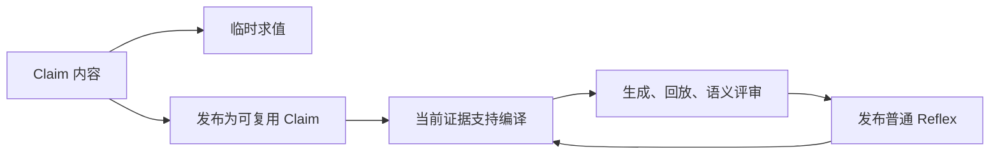

# JEV：Claim 与 Reflex

每一次 JEV 语义判定都表达为 Claim。Claim 只描述判定内容；是否复用、何时调用、如何取证、如何编译和发布，由使用它的组件负责。

```json
{"type":"choice","context":"根据当前记录选择下一步。inspect 表示读取新证据，report 表示报告已确认结果，defer 表示需要补充推理。","options":["inspect","report","defer"]}
```

## 判定内容与结果

Claim 只有 `type`、自然语言 `context` 和有序字符串数组 `options`。事实、选项含义和判定标准直接写入 context；不再增加 Question、criteria 或业务请求对象。

| type | options | Evaluation 的值 |
| --- | --- | --- |
| choice | 2–64 个不同的候选结论 | 数组中的一个字符串 |
| score | 2–10 个从低到高排列的等级 | 加权等级索引，范围为 0 到 options.length−1，可以是小数 |
| noul | 不提供选项 | context 成立的概率，范围为 0 到 1 |

Context 最多 64 KiB，每个选项最多 1 KiB；空内容、重复选项、未知类型和旧字段会被拒绝。评分选项的顺序定义量表；所有 Claim 的内容身份都保留数组顺序。

[Provider](../agent/provider/jev/claim.go)提供封闭的三种类型，[决策协议](../proto/decision/claim.proto)用 oneof 表达结果。阈值和后续动作由调用者决定。批量 Evaluate 的 token 用量属于此次执行；厂商的 state/questions/criteria 请求仅存在于内部传输适配层。

## 职责与生命周期

临时 Claim 可以直接 Evaluate，无需进入库。适用性检查、运行时授权、完成检查以及 guardrail 都使用这一入口。当前证据附加在本次调用的 context 中，记录于决策事件，不改变持久化 Claim。

需要复用的 Claim 可以发布到库。其 ID 由 type、context 和 options 的内容计算；重复发布复用同一个 ID。库记录只额外保存来源任务，快照复制选项数组，发布通过原子持久化完成。生成流程和原生命令共用同一条发布路径。



证据一旦就绪，就在当前边界判断是否编译，包括第一个任务；来源任务不构成等待条件。Claim 定义判断的语义范围，Reflex 持有可执行函数、参数 schema、原生契约、效果次数及验证记录。一个 Reflex 可以覆盖多个 Claim，Claim 不保存“已消费”标记。

编译失败保留 Claim，提交的源码和具体诊断记录在编译事件与审计日志中，不写入库。修复通过验证并成功持久化后发布新 Reflex，同时在同一个库中归档原定义；失败保留原来的发布结果。退役只记录归档事实和原因，后续编译可以读取原源码，归档程序不参与执行或覆盖判定。`learning=frozen` 禁止学习写入，仍允许临时判断和已验证 Reflex 的复用。

后台 Claim 生成和编译的单次 LLM 请求使用 30 分钟兜底期限，独立于前台 Provider 的短请求超时。总编译期限 `compilation_timeout` 默认 `0`，允许普通编译 Agent 持续生成、验证和修复；显式配置正值才增加整体兜底。扩展关闭或宿主取消仍立即终止请求。超时用于回收异常挂起，不用于限制正常编译耗时。

每次纯离线回放最多执行 5 秒；它只读取已有结果、枚举有限语义分支，不调用真实工具或模型。生成源码空转或计算超限时返回 `replay_execution_limit`，编译 Agent 可以继续修复；这不改变整体编译期限或真实工具的执行期限。

编译器沿用宿主 Agent 的临时 Provider 错误重试策略；取消、非重试错误和已耗尽的上下文仍终止。`finish_reason: length` 表示不完整输出，即使包含看似完整的工具调用也不会执行；编译器将输出预算从 16,384 逐步扩大到 65,536 后重新生成，并保留每次请求的用量。上下文不足或最高预算仍耗尽时报告明确失败，保留 Claim 和编译诊断。

JEV 判定使用 32 KiB 的私有证据投影，编译回放另保留完整的宿主调用/结果轨迹。投影省略早期证据不会删除编译器的实际记录；自动归纳和普通 `jev compile` 使用相同边界。独立语义评审共享一份当前实际轨迹，系统约束和此前用户要求各保留一次；报告保留已校验的 evidence/path 引用。回放的修复诊断由验证器直接读取，语义评审只接收分支结果与共享原生调用，避免逐边界复制结果、诊断和机制资格摘要。超出 Claim 上下文限制仍返回 `review_input_limit`，不能通过截断证据或跳过审查发布。

回放失败的工具反馈提供尚未消费的 `remaining_recorded_calls`，保留失败读取、最后确认、原生参数及顺序。语义评审超限的诊断提供各部分字节数，帮助定位重复输出；所有验证门槛仍保留。

编译产物的 `when` 描述用户任务入口适用性，`decide` 描述函数负责的工作和完成/交接条件。使用参数的产物必须声明 schema，独立评审检查所有必需值能在入口取得；函数自己创建的资源名与已经存在的句柄有不同来源，原生检查才能发现的地址由函数内部取得。Claim 的错误选项不会被拼入 Reflex 的适用描述。

运行时参数提取直接接收原始约束文本、当前证据和 schema，省去源码与样例。截断时将输出预算从 2,048 逐步增加到 8,192，全部尝试计入前台用量，部分值不进入执行。宿主提供一次提取专用的唯一名称，仅供 schema 明确描述的新建资源使用；已有句柄和业务字段仍须来自当前证据。运行时审查直接读取原始约束文本，按 schema 解释字段的编码形式；绑定判定只接收当前调用的工具协议，宿主继续验证完整原生契约及效果身份。结构化原生结果直接保存为 JSON，避免重复转义挤出实际轨迹，原始日志和 JavaScript 读取接口保留原值。接管及验证的整体期限使用 30 分钟兜底。参数交接失败且没有保留或派发任何效果时，释放普通执行；同一输入下不反复选择这个失败函数，新用户输入或不同函数可再尝试。存在已知或未知效果时继续保护日志，避免重复写入。

持久库只有 `claims` 和 `reflexes` 两个集合。Claim 记录包含统一的 `claim` 内容与来源 `task`；Reflex 由可执行的 `Program` 和 Claim 归属、依赖摘要、归档事实组成。Claim ID 只取决于 Claim 内容，Reflex ID 只取决于 Program；来源任务、Claim 归属和归档不会改变它们的身份。库限制为 32 个 Claim、16 个已发布程序和 2 MiB，归档程序计入总字节容量。写入仍通过临时文件、同步与原子替换完成，持久化成功后才更新内存。

首版只接受这一种结构。库没有格式版本、候选集合、旧格式读取、自动迁移或备份扫描路径。未知字段、损坏内容、失效引用和不匹配的内容 ID 直接报错，原文件不被重写。已发布程序加载时重新检查源码与当前原生契约；失去资格的定义在本库归档，重新发布必须再次通过验证。

Claim 生成只接受完整的 `{"claims":[...]}` JSON 对象，空数组表示没有新 Claim；裸数组、围栏、空值、未知字段或追加正文直接拒绝，生成事件保留原始对象。编译器只接收完整的 JSON 产物或 `null`。产物声明 `when`、`decide`、`observe`、参数 schema、效果步骤及可选 readers；`observe` 是 `js:` 开头的同步函数，入口缺失直接进入编译诊断，不补造默认描述。示例 `arguments` 仅用于本次回放，发布时从内存与持久库一起去除。源码、参数、效果身份、原生契约、完整回放和语义评审始终走同一条校验路径。

资格直接使用生成的 `ReflexQualification` 类型。协议中的 `qualification`、`steps`、`parameters_schema`、`archived` 和 `archive_reason` 均为结构化字段，界面不再解析资格或 manifest 的 JSON 字符串。事件仍保留发生时的定义快照，历史回放不查询最新库来替代当时源码。供应商的 questions/answers JSON 只在 Provider 内部转换，运行与扩展统一使用 Claim / Evaluation。

## 普通 Reflex 的自举

空库从实际交互归纳 Claim，并按同一证据门槛生成普通 Reflex。系统没有专用 bootstrap Reflex、特权 ID、额外源码类型或验证豁免。

安装 JEV 扩展后，现有原生命令提供：

```text
jev status
jev claim <Claim JSON>
jev compile <claim-id> [replace-reflex-id]
```

`status` 读取当前库；`claim` 发布内容并返回 `claim_id`；`compile` 以宿主记录的当前交互请求编译，返回目前覆盖该 Claim 的 `reflex_ids`。返回空数组表示尚无已发布覆盖，编译可能因证据不足或冷却而推迟。替换目标必须已经覆盖所选 Claim。

普通模型和任意普通 Reflex 都可以通过原生 Executor 调用这些操作。`jev-library` 契约将 status 分类为读取，将 claim/compile 分类为库写入；Reflex 中的写入仍需声明效果步骤和次数，通过运行时判定、效果日志与原生验证。命令不能接收调用者编造的轨迹或直接发布源码。编译器只回放已有结果，不执行用户工具。

每次原生调用完成后，宿主立即保存真实结果，供同一执行中的下一次编译使用。在途调用没有结果，不能成为回放证据。原函数替换成功后，已开始的执行继续使用其源码快照，下一次选择使用新库。

## JavaScript 判定桥

`jev` 直接接收 Claim 并返回对应原始值：

```javascript
const next = jev({
  type: "choice",
  context: "根据当前证据选择 inspect、report 或 defer。" + JSON.stringify(currentFacts),
  options: ["inspect", "report", "defer"]
});
const severity = jev({type: "score", context: "评估当前风险。", options: ["低", "中", "高"]});
const complete = jev({type: "noul", context: "当前真实结果已经完成用户请求。" + JSON.stringify(currentResult)});
```

返回值分别是字符串、等级索引和概率。确定性的解析、转换和控制流直接用 JavaScript；只在语义分叉处调用 JEV。旧的 `jev({state,questions}).answers` 形式不再接受。

[生命周期测试](../exts/jev/claim_lifecycle_test.go)覆盖首个证据边界、普通 Reflex 自我替换、失败回滚和退役后的 Claim 保留；[类型测试](../agent/provider/jev/claim_test.go)覆盖序列化、旧字段拒绝、结果类型和数值边界。

## 完整机制验证

[连续链路测试](../exts/jev/claim_pipeline_test.go)从空库启动普通 Agent，经原生 Executor 取得随机回执，归纳 typed Claim，向普通编译 Agent 提交错误参数并接收回放诊断，修复后通过原生契约、回放和独立语义评审发布 Reflex。随后重新加载持久库，以不同目标和相同目标运行三个新任务，检查当前参数、新回执、一次读取、无重新规划或编译，以及冻结库不变。choice、score、noul 都运行这条链路。测试也检查带引号参数的 Bash 解码，以及语义评审收到已解析的真实报告值。

```text
go test ./agent/provider/jev ./exts/jev ./exts/guardrail ./pkg/web/service ./cmd/aiscan -count=1 -timeout 120s
go test -tags 'emptytemplates forceposix full netgo noembed osusergo sqlite' ./agent/provider/jev ./exts/jev ./exts/guardrail ./pkg/web/service ./cmd/aiscan -count=1 -timeout 120s
go test -race ./exts/jev -run 'TestClaim|TestOrdinaryReflex|TestReflex(Compiler|Frozen|.*Effect|.*Unknown|.*Steer)' -count=1 -timeout 120s
go test -tags 'full sqlite' ./cmd/aiscan -run '^TestJEVProfileStreamingCompilationRuntimeAndProtocolEvents$' -count=1 -timeout 120s
```

普通测试只替换模型推理，仍使用真实宿主和验证器。`TestLiveClaimToReflexPipeline` 提供两个明确区分的真实接口模式：设置 `JEV_PIPELINE_LIVE=1` 和 `TYPESAFE_API_KEY`，所有 JEV 判定调用真实接口，LLM 生成仍由固定测试响应提供；额外设置 `JEV_PIPELINE_LLM_LIVE=1`、`CYBER_API_KEY`、`CYBER_BASE_URL`、`CYBER_MODEL`、`CYBER_PROVIDER`，则 Claim 生成、编译、参数提取和最终整理也调用真实 LLM。

```text
go test ./exts/jev -run '^TestLiveClaimToReflexPipeline$' -count=1 -v -timeout 3h
```

可设置 `JEV_PIPELINE_REPORT_DIR` 保存 `pipeline-report.json`、`library.json`、决策日志、原生执行证据和完整 JEV 事件。每次使用新的报告目录，以保证真正从空库启动；日志不记录凭证。真实接口测试会检查完整验收条件，defer、未发布源码、模型调用失败或新任务重新规划都会导致失败，不能作为成功的端到端验证。

## Token 与成本的判定

Reflex 将已验证流程的重复规划变为普通代码执行和有限语义判断，因而可以减少重复任务的 LLM token。节省取决于原流程需要多少推理和历史上下文；一次读取再报告的短任务仍需要参数提取和答案组织，可能没有净节省。

比较时分别记录前台 LLM、Claim 生成、Reflex 编译和 JEV 的输入与输出 token。参数提取计入前台 LLM，不能在前台汇总后再次相加；reasoning 已属于输出 token，不能重复计数。未知用量和失败重试不能当作零成本。不同模型的 token 单位、单价和缓存计费可能不同，所有 Provider token 的合计仅是工作量指标，费用必须按实际单价计算。

设基线每任务用量为 B，复用每任务用量为 W，学习及编译的额外用量为 C；重复 N 个任务后的净节省为 `N × (B − W) − C`。只有 B 大于 W 才能摊薄首次成本；价格不同则将公式中的用量换成实际费用。现有 [A/B 基准](../exts/jev/benchmark_live_test.go)分别报告前台 LLM、全部 LLM、全部 Provider、首次成本、复用费用和回本任务数；[记账测试](../exts/jev/token_accounting_test.go)验证分类汇总、负节省和缺失用量。

## 真实浏览器与界面验收（2026-10-25）

[真实浏览器验收](../exts/jev/playwright_takeover_live_test.go)使用 `https://sub.chainreactors.cn/v1` 的 `deepseek-flash`、真实 TypeSafe JEV 和 Chromium。Agent 通过生产 Extension、终端和原生 `playwright` 命令执行三个隔离业务应用；该原生命令由 Go Rod 驱动。服务端独立 oracle 检查随机业务字段、效果次数、错误操作和实际回执，不向模型提供控制接口凭证或预期答案。

Shadow DOM 客户保存、两次加购后结算均已从空库生成并发布 Reflex，各通过一组冷/热 Off/Auto 对照。最新代码又通过生产 Loader 重载这些真实生成的库，冻结学习，在新 URL、字段和控件地址上复用，源码哈希不变：

| 场景 | 最新复用业务正确 | 正式热任务原生调用 | 主模型工具调用 | 正式热任务前台耗时 |
| --- | --- | --- | --- | --- |
| Shadow DOM 客户保存 | 2/2 | 6 | 0 | 7,003 ms |
| 两次加购后结算 | 2/2 | 8 | 0 | 8,369 ms |

每个重载场景包含额外复用预检和一个正式热任务。Shadow DOM 预检发生参数交接回退，业务正确但未完整接管；正式热任务完整接管。加购两次任务均完整接管。重载复用与同轮从空库冷/热验证分别记录，不能混为同一运行。

首次报销编译暴露评审重复复制原生结果、完整报告和修复诊断，超出 64 KiB 限制；失败运行已保留并主动中止。修复后，同一真实轨迹离线评审输入为 57,418 bytes，保留实际结果和任务约束；该离线检查使用模拟语义答复，只验证证据传递和预算，不代表真实语义通过。另一次普通模型生成复合 shell 命令，原生契约拒绝其回放；该完整轮次四个任务业务均正确，但未发布 Reflex，热接管为 0/1。明确使用原生等待操作后的最后一轮仍反复提交与实际记录不匹配的调用，主动中止，未发布、未完成热接管验收。因此报销及提交后恢复场景仍未通过，不能将本次验证称为三个场景全部通过。

冷编译成本仍可能较高，已完成的加购冷任务记录约 124 万 LLM token。热任务工具接管通过不代表全程 token 或费用降低。所有失败与中断轮次保留；不把未知用量记为零，也不将未覆盖的弹窗、跨源 frame、文件传输或拖放宣称为已验证能力。

复现时设置 `CYBER_BASE_URL`、`CYBER_MODEL`、`CYBER_API_KEY`、`TYPESAFE_API_KEY` 和可选 `CYBER_BROWSER_PATH`，使用完整能力构建及新的报告目录：

```text
JEV_TAKEOVER_LIVE=1
JEV_TAKEOVER_CASES=shadow,repeat,expense
JEV_TAKEOVER_WARM=1
JEV_TAKEOVER_REPORT_DIR=<新的报告目录>
go test -tags "forceposix emptytemplates noembed osusergo netgo full sqlite" ./exts/jev -run '^TestLivePlaywrightTakeoverMatrix$' -parallel 3 -count=1 -v -timeout 90m
```

也可以先 `go test -c` 构建测试程序，再将 `{llm,jev}` 凭据 JSON 从标准输入交给 [runner](../exts/jev/testdata/playwright_takeover_runner.mjs)，测试程序路径为其第一个参数。凭据只进入子进程环境，输出按完整行脱敏，不写凭据文件。重载验证额外设置 `JEV_TAKEOVER_RELOAD_DIR=<真实冷任务报告目录>`，普通 Loader 仍检查资格和当前原生契约。

`report.json` 包含成功、失败、回退和用量，`source.json` 记录本轮源码 SHA-256。`llm.jsonl`、`decisions.jsonl`、`events-*.json`、`library-*.json` 和 `library.json` 保留请求、决策、原始 AOP 事件与库快照；运行产物不进入源码库。

[界面验收](../web/frontend/e2e/jev-live-acceptance.spec.ts)使用官方 Playwright 读取上述真实报告和协议事件，校验业务 oracle、热任务接管、实际派发次数、资格与源码稳定性，再通过生产组件检查执行时间线和库面板、桌面与手机布局及页面错误。设置 `JEV_ACCEPTANCE_REPORT_DIR` 和 `JEV_ACCEPTANCE_CASES` 后运行 `npm --prefix web/frontend run test:jev -- --grep real.*Reflex`。这是实际后端/浏览器执行证据的 UI 回放验证；任务没有通过完整生产 Web 界面提交。
